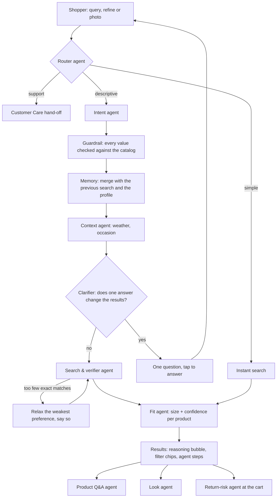

# SearchSense: final presentation brief

**ABHIKALP 2026 · Team Outliers · Grand Finale**
**Case 3 · D2C Retail & E-Commerce**

**SearchSense** is a B2B SaaS that makes the search bar of fashion, lifestyle and personal-care e-commerce platforms and D2C brands **agentic**. A team of AI agents understands what the shopper actually means, asks only when it must, finds products that meet every need, recommends the right size, and catches size and style returns before checkout.

Live MVP: https://searchsense-e8rmkpxmrlrncputsvc6p2.streamlit.app/ · finals walkthrough: **🎬 Demo** tab · code: `ui-redesign` branch

This file is the single source for the final deck and pitch. It follows the six required areas in order, and covers every evaluation criterion (see the map below). **"Say"** lines are speaker notes for a conversational delivery.

---

## How this brief maps to the evaluation

| Evaluation area (weight) | Assessed on | Where it's covered |
|---|---|---|
| **Product Management (40%)** | Problem & persona definition | §1 Problem, customer and personas |
| | Product scope & features | §4 Agents, features, scope decisions; §5 roadmap |
| | Market opportunity & ROI | §3 Market potential, ROI, business model |
| | Execution & risk strategy | §5.2 Execution plan, §5.3 Risks and mitigations |
| **Solutioning (40%)** | Agentic architecture & orchestration | §4.3 Architecture and orchestration |
| | Functional reliability & demo | §4.6 Reliability, §7 Demo run-of-show |
| | Technical readiness | §4.7 Technical readiness and maturity |
| **Grand Finale (20%)** | Pitch clarity & storytelling | §0 Story arc; "Say" lines; §8 slide plan |
| | Live demo & execution | §7 Demo run-of-show (🎬 Demo tab) |
| | Q&A & stress-test defence | §9 Q&A bank (20 questions) |
| | Maturity & readiness | §4.7 Built / simulated / planned |

### Decisions we've made
1. **Beachhead:** fashion, lifestyle and personal-care e-commerce platforms and D2C brands in India (the case), with fashion first because returns hurt most there. Quick commerce, electronics and grocery come later (scalability, §5).
2. **Goals = the case's targets:** **+20% search-to-checkout conversion** and **−15% size- and style-related returns**. Every feature is tied to one of these (§4.4).
3. **Positioning:** we make the **search bar itself agentic**. It's not another chatbot, and it carries the shopper from query to size to a return-safe cart.
4. **Business model:** SaaS, priced **per AI-mode search**, with simple searches free.
5. **Demo:** scripted for reliability (saved answers, labelled "demo script" in the trace), plus one **live, off-script query** to prove it's real.

---

## 0. Story arc and one-liner

> **Shoppers don't search in keywords. They describe a situation.**
> SearchSense turns the search bar into a team of AI agents that understands the situation, finds what fits, sizes it right and stops the return before it happens.

**The story (use it to open and close):**
- **Act 1, the pain.** Priya has a daytime wedding in Mumbai. She types exactly what she needs into Myntra and gets "No results". On Amazon she gets three western dresses under a row of silver bracelet ads. She scrolls, gives up, or buys the wrong thing and returns it. *(Screenshots.)*
- **Act 2, the shift.** The same sentence in SearchSense: the agents understand humid, daytime, pastel, ethnic, ₹6,000 and silver. They show exactly what they understood, size every product from her own history, and stop a wrong-size order at checkout.
- **Act 3, the business.** For a platform, that's more checkouts and fewer returns, delivered as SaaS in weeks, for about a paisa a search.

---

## 1. Problem statement & target customer

### 1.1 The problem (from the case)
Fashion, lifestyle and personal-care e-commerce platforms face **68–75% cart abandonment** and **25–35% return rates in apparel**. A main driver is **discovery fatigue**: shoppers scroll through thousands of SKUs with **rigid keyword filters** that can't capture **multi-constraint, subjective intent**:

> *"I need a breathable, pastel ethnic outfit for a humid daytime wedding in Mumbai under ₹6,000 that pairs well with silver jewelry"*

**High-intent shoppers drop off or return items** because static keyword search and generic recommendation carousels can't reason about:

| What search can't reason about | Example | Result today |
|---|---|---|
| **Lifestyle context** | "humid daytime wedding in Mumbai", "trip to Jaipur in January" | Zero or irrelevant results; the shopper must translate the situation into filters |
| **Visual aesthetics** | "pastel", "dark shades that go with gold", "floral", "pairs with silver jewellery" | Colour, print and pairing are lost in keywords |
| **Sizing nuances** | "this brand runs small", "I returned a kurta in S" | Generic size chart → wrong size → return |
| **Conversation** | "same but in blue", "#2 but cheaper" | Every refinement starts from scratch |
| **Ambiguity** | "marriage outfits", "outfits for jaggu" | Guesses instead of asking |

**One root cause:** search matches words; it doesn't understand intent. **Two business outcomes:** lost conversions and avoidable returns.

### 1.2 Target customer (who buys) and primary user (who uses it)
SearchSense is sold **business-to-business** and used by shoppers.

**Customer (beachhead):** fashion, lifestyle and personal-care **e-commerce platforms and D2C brands** in India.

| Segment | Why they buy |
|---|---|
| **Fashion and lifestyle marketplaces** | Search drives their most valuable sessions; apparel returns cost them the most |
| **Beauty and personal-care platforms** | Needs-based queries ("fragrance-free, for oily skin") that keywords can't match |
| **D2C brands** (own app or site) | Same problem, but no AI search team in-house; need it plug-and-play |

**Buyer persona** *(illustrative)*: **Neha, Head of E-commerce at a fashion D2C brand.** Owns conversion and return rate; under pressure on reverse-logistics cost; can't hire an AI team; needs proof through an A/B pilot.

**Primary user:** the online shopper in India who starts at the search bar. Mobile-first, often shopping for an occasion, a trip or someone else, and writing the way they speak: Hinglish, short forms, typos.

**Shopper personas** (from our solution doc; all three are live as profiles in the MVP):

| Persona | Situation | What fails today | What they need |
|---|---|---|---|
| **Priya**, 27, wedding guest | "Breathable pastel ethnic outfit for a humid daytime wedding in Mumbai under ₹6,000" | Zero or irrelevant results | Her whole situation understood in one go, and the right size |
| **Rohan**, 24, quick shopper | "wite linnen shirt M": fast, with typos | Typos give no results | Fixed silently, with one-tap undo, and no AI wait |
| **Ananya**, 31, fit-anxious | Returned jeans for being too small; unsure of her size | Generic size chart | A size that learns from her own returns, and says why |

**Inside the customer, who else uses it:** the search and merchandising team (client console: what shoppers ask for, what failed, KPIs), the catalog team (listings missing attributes are flagged), and finance (lower return cost).

**Say:** "The case gives us the numbers: up to 75% of carts abandoned and up to 35% of apparel returned. Behind them is one moment: a shopper types exactly what she needs, and search doesn't understand her. We built for Priya, Rohan and Ananya, and we sell to the platforms and brands that serve them."

---

## 2. Competitor analysis & market research

### 2.1 What we tested (October 2026, live sites, same queries)

| Query / ask | Myntra search | Amazon search | SearchSense |
|---|---|---|---|
| Case query, word for word | **"No results"** | **3 results, all off-target:** western dresses, not ethnic; the top of the page is sponsored silver bracelets; an unrelated hair-straightener ad | Ethnic, pastel, breathable outfits under ₹6,000 that suit silver, every constraint shown as a chip, and a size on each card |
| *"tshirts for Manali"* (situational) | Ads and mixed men's/women's results; no idea Manali is cold | *to test* | Keeps the t-shirts, knows it's cold, warns, and offers a warm layer in one tap |
| *"Return last order"*, *"Track my order"* | Treated as a product search | Treated as a product search | Recognised as support and handed to Customer Care |
| Refine: *"same but in blue"*, *"#2 but cheaper"* | Not possible in the search bar (filters only) | Not possible in the search bar (filters only) | The conversation continues: only what you changed changes |
| Ambiguous: *"Marriage outfits"*, *"outfits for jaggu"* | *to test* | *to test* | Asks **one** question (Ethnic or western? Is Jaggu a man or a woman?) |
| Typos and Hinglish: *"vlue tops with flower under 700"*, *"shaadi ke liye kurta"* | *to test* | *to test* | Fixed and mapped (blue, floral print, under ₹700; shaadi → wedding) |
| Size, inside search and before checkout | Size help on the product page | Size suggestions on some fashion products | A size on every result card with the reason, plus a pre-checkout size check |

*Put the dated screenshots on the slide. Fill or drop the* to test *cells: show only what we actually tried.*

### 2.2 The competitive landscape: four kinds of players

| Type | Players | What they offer | What's missing for our customer |
|---|---|---|---|
| **1. In-house marketplace assistants** | Myntra **Maya** / **MyFashionGPT** (2023, with Microsoft), Amazon **Rufus** (India beta Aug 2024, over 1 crore users), Flipkart **Flippi** (Oct 2023) | Chat assistants inside their own apps | **Not for sale**: D2C brands and smaller platforms can't get them; separate from the search bar, which still fails (our tests) |
| **2. Global search & discovery SaaS** | Algolia, Constructor, Bloomreach, Coveo | Keyword and semantic search, merchandising; newer AI shopping agents (Constructor AI Shopping Agent, Bloomreach Loomi, Algolia NeuralSearch on its top tier) | Built for Western catalogs and enterprise budgets; no size or return-risk check in the flow; little Indian context (haldi, sangeet, city weather, Hinglish, ₹ budgets) |
| **3. Search SaaS from India** | Netcore **Unbxd** (Indian-owned; named a Leader in Gartner's 2026 Magic Quadrant for Search and Product Discovery) | AI search, merchandising, recommendations for merchants and D2C | Search and merchandising focus; sizing, returns and support routing aren't part of the search flow |
| **4. Fit & size SaaS** | True Fit, Fit Analytics (Snap) | Size recommendation on the product page from sales and returns data | Starts after search; doesn't understand the query, occasion or aesthetics |

### 2.3 Compared on every aspect
✓ = yes · ◐ = partly, or a separate add-on · ✗ = no. *Based on public material and our own tests; recheck before the slide.*

| Aspect | Marketplace search bars (Myntra, Amazon) | In-house assistants (Maya, Rufus, Flippi) | Global search SaaS | Unbxd | Fit SaaS | **SearchSense** |
|---|---|---|---|---|---|---|
| Where it lives | Search bar | Separate chat | Search bar | Search bar | Product page | **Search bar → product → cart** |
| Understands full sentences | ✗ (our tests) | ✓ | ◐ | ◐ | ✗ | **✓** |
| Lifestyle context (weather by city and month, occasion and time) | ✗ | ◐ | ✗ | ✗ | ✗ | **✓** |
| Visual aesthetics as filters (colour family, print, sleeves, neckline, pairs with silver or gold) | ◐ (manual filters) | ◐ | ◐ | ◐ | ✗ | **✓ from one sentence** |
| One clarifying question, only when needed | ✗ | ◐ | ◐ | ✗ | ✗ | **✓** |
| Conversational refine with memory | ✗ | ✓ (in chat) | ◐ | ✗ | ✗ | **✓ in the search bar** |
| Never a dead end (relaxes and explains) | ✗ ("No results") | ◐ | ◐ | ◐ | ✗ | **✓** |
| Support requests routed | ✗ (our tests) | ◐ | ✗ | ✗ | ✗ | **✓** |
| Size from the shopper's own orders, brands and returns | ◐ (product page) | ◐ | ✗ | ✗ | ✓ (product page) | **✓ on every result** |
| Pre-checkout return-risk check | ✗ | ✗ | ✗ | ✗ | ◐ | **✓** |
| Hinglish and Indian occasions | ◐ | ◐ | ✗ | ◐ | ✗ | **✓** |
| Shows its reasoning | ✗ | ◐ | ✗ | ✗ | ◐ | **✓** |
| Available to D2C brands and other platforms | ✗ | ✗ | ✓ | ✓ | ✓ | **✓ (SaaS)** |
| Pricing | — | — | Per search or enterprise (Algolia Grow ≈ $0.50 per 1,000 searches; AI on higher tiers) | Enterprise | Enterprise | **Per AI search; simple searches free** |

### 2.4 Market research: why this is worth solving
- **The case:** 68–75% cart abandonment; 25–35% apparel returns; discovery fatigue is a primary driver.
- **Searchers are the best customers:** they convert at about **2.5×** non-searchers (Algolia).
- **Search often fails:** **10–15%** of searches on an average e-commerce site return **zero results** (Baymard, via secondary sources).
- **Returns are costly in India:** fashion returns are reported at **25–40%**, overall **15–30%**; brands could lose **$20–30B** to returns (Return Prime estimate). *These are industry estimates; quote them as "reported".*
- **Fit tools prove the lever:** True Fit reports a **24% cut in fit-related returns** at Moosejaw by targeting size bracketing (vendor-reported).
- **Incumbents validate demand:** Myntra, Amazon and Flipkart all built AI assistants in-house; most of the market can't.

### 2.5 The gaps we fill
1. **Nobody does search → size → return-safe cart in one flow.** Search SaaS stops at results; fit SaaS starts at the product page.
2. **The best assistants are locked in-house.** D2C brands and mid-size platforms can't get them.
3. **Global tools miss India:** Hinglish, haldi and sangeet, city weather, ₹ budgets.
4. **Search bars still break on exactly the case's query.** That's our proof.

**Say:** "We tried the case query ourselves. Myntra: no results. Amazon: three western dresses under bracelet ads. The big marketplaces built chat assistants, but only for themselves, and their search bars still break. Search vendors stop at results, and fit vendors start at the product page. Nobody owns the whole journey, and nobody is built for how India shops."

---

## 3. Market potential

### 3.1 Market size
- **India online retail:** about **$65–66B GMV in 2025**, growing over 20% a year to **$170–180B by 2030** (Bain & Company). Fashion, lifestyle and personal care are among the largest and most return-heavy categories.
- **Expansion headroom:** quick commerce reached about **$10–11B in 2025** and is forecast at **$65–70B by 2030** (same report).

### 3.2 Impact for one platform: per ₹10,000 crore of GMV
*Assumptions are labelled; the targets come from the case.*

| Lever | How we compute it | Value a year |
|---|---|---|
| **+20% search-to-checkout** on AI-mode searches | 35% of GMV is search-led *(assumption)* → ₹3,500 cr; 35% of those searches are descriptive and go to AI mode *(assumption)* → ₹1,225 cr influenced; +20% (target) / +5% (conservative) | **+₹245 cr** GMV (target) · **+₹61 cr** (conservative) |
| **−15% size- and style-related returns** | ₹1,000 average order → 10 cr orders; **30% returned** (case: 25–35%); **half** of those size or style related *(assumption)* → 1.5 cr; −15% | **22.5 lakh fewer returns**: **₹225 cr** of GMV kept, **≈ ₹34 cr** of handling saved at ₹150 a return *(assumption)* |
| **Lower cart abandonment** | Size certainty and honest product answers at the moment of choice | Upside; tracked in the pilot, not counted here |

### 3.3 What it costs to run
- **Per AI-mode search:** about 8,200 input tokens and 350 output tokens on a fast model (Gemini Flash family, with Cohere as backup).
- **At Gemini 2.5 Flash-Lite list prices** ($0.10 / $0.40 per million input / output tokens; cached input $0.01): **₹0.02–0.08 per AI search**, or **₹20–85 per 1,000**.
- **Platform at 1 crore searches a day:**
  - 35% go to AI mode, and about 30% of those are answered from cache *(assumption)*.
  - That's about 24.5 lakh model calls a day: **≈ ₹2–8.5 crore a year** including photo reading and product questions.
  - Across all traffic, that's **half a paisa to two paise per search**.

### 3.4 ROI
For a platform with ₹10,000 crore GMV, **₹61–245 crore** more GMV plus **₹225 crore** of GMV not returned, against an AI cost in the low single-digit crores. **The payback is many times over**, even at the conservative lift.

### 3.5 Business model (SaaS)

| Plan | For | Price *(proposed)* |
|---|---|---|
| **Enterprise** | Marketplaces and large platforms | **₹0.25 per AI-mode search** (simple searches free); optional success fee on uplift measured in the A/B pilot |
| **Growth** | Vertical platforms, large D2C brands | Same usage price with a monthly minimum; fit and return-risk modules included |
| **Self-serve** *(future)* | Small D2C stores (Shopify-style plug-in) | e.g. **₹15,000 a month** including 1 lakh AI searches |

**Unit economics:**
- **Gross margin:** our cost is ₹0.02–0.085 per AI search, so the gross margin is **about 66–92%**.
- **Example customer at 1 crore searches a day:** about 128 crore AI-mode searches a year, so **≈ ₹32 crore ARR**, at a 73–94% gross margin.
- **Why we charge more than Algolia:** it lists keyword search at about $0.50 (≈ ₹44) per 1,000 searches. We charge more per search because we sell **outcomes** (conversion, returns), not queries.

### 3.6 TAM · SAM · SOM

| | Definition | Size | Basis |
|---|---|---|---|
| **TAM** | Global e-commerce search software | **~$4–5.5B** (2024–25), ~11% a year | Market reports; estimates vary by definition |
| **SAM** | Search and discovery spend of e-commerce in India | **~₹575 crore (2025) → ~$175M by 2030**; beachhead (fashion, lifestyle, beauty) roughly 40% of that | *Assumption:* about 0.1% of e-retail GMV; *assumption:* category share |
| **SOM (3 years)** | What we can win | **~₹100 crore ARR** | *Assumption:* 3 large platforms (≈ ₹32 crore each) + 50 D2C brands on self-serve |

**Say:** "Searchers are already the best customers. We only need to fix the third of searches that are descriptive. At the case's targets, that's ₹245 crore more GMV and 22 lakh fewer returns for every ₹10,000 crore. It costs us about a paisa a search to run, we charge 25 paise, and the customer still earns many times what they pay."

---

## 4. Solution & differentiation

### 4.1 What SearchSense is
An **agentic AI mode for the search bar**, sold as SaaS. A team of specialised agents works on every search: each does one job, checks the others' work, and hands over to the next. The shopper sees a familiar search bar and product grid, plus the reasoning.

### 4.2 The agents

| Agent | Job |
|---|---|
| **Router agent** | Reads every query and picks the path: simple → instant search; support → Customer Care; descriptive → the intent agent |
| **Intent agent** | Turns a sentence into **must-haves** (category, gender, budget, item, style) and **preferences** (occasion, time, colours, colour family, fabric, fit, print, sleeves, neckline, pairs with); fixes typos and Hinglish; spots out-of-catalog asks and support requests |
| **Context agent** | Brings in the world: **weather for the place and month** (Jaipur in January is cold; the Maldives is humid) and **occasion rules** (a daytime wedding means lighter shades) |
| **Clarifier agent** | Asks **one** question, only when the answer would change the results |
| **Search & verifier agent** | Finds candidates, **checks each product against every constraint**, and if too few match, **relaxes the weakest preference first and says so**, never the budget or the item |
| **Memory** | Keeps the conversation: a refine changes only what the shopper said; each profile remembers orders, sizes and behaviour |
| **Fit agent** | A size for **every** product, with confidence and the reason: usual size, the brand that fits best (with brand conversion), **the shopper's own returns** and product fit signals. When unsure, it asks one fit question instead of guessing |
| **Vision agent** | Reads a photo of a size tag, bill, label or garment → sets the size, or searches for the item |
| **Product Q&A agent** | Answers on the product page ("Is this see-through?") using only that listing, and says when the listing doesn't tell us |
| **Look agent** | Suggests what goes with a product when you view it and right after you add it to the cart |
| **Return-risk agent** | At the cart: wrong size ("you picked S, but it runs small: switch to L?"), two sizes of the same item (bracketing), and honest notes |

### 4.3 Agentic architecture & orchestration

**How the agents are orchestrated:**
- **A shared contract.** Agents pass one structured intent (must-haves, preferences, context, clarifying question, reasoning) from step to step. Every value is checked against the catalog's own vocabulary before anything is searched.
- **Plan → act → check → adapt.** The router decides the plan; the verifier checks every product; when results are too thin, the loop relaxes a preference and searches again; the clarifier can stop the plan to ask.
- **Tools:** the catalog index, the weather estimate, occasion rules, the shopper's profile, orders and returns, and the photo reader.
- **Memory:** the conversation (refines) and the profile (sizes, brands, orders, behaviour).
- **Model layer with fallbacks:** the primary model (Gemini), then other Gemini models, then a backup provider (Cohere), then normal search. **The shopper is never worse off than today.** The primary provider can be switched from the console.
- **Observability:** every search and every agent step is logged with timings in the client console.

### 4.4 How each feature moves the case's two targets

| Target | Lever | Feature |
|---|---|---|
| **+20% search-to-checkout** | Fewer zero or irrelevant results | Intent agent, context agent, verifier with relaxation, out-of-catalog alternatives |
| | No restarts while refining | Conversational refine with memory, one-tap refines, one clarifying question |
| | Confidence to buy now | Size on every card with the reason, product Q&A, honest notes, transparent reasoning |
| | Bigger, better baskets | Look agent (on view and after add to cart), "Picked for you" per profile instead of generic carousels |
| **−15% size- and style-related returns** | Right size first time | Fit agent from own returns and brand anchors; one fit question instead of a guess; size chart |
| | Stop the return before checkout | Return-risk agent: wrong-size switch, bracketing guard |
| | No style surprises | Aesthetic filters (colour family, print, sleeves, neckline, pairing), product Q&A ("see-through?"), honest notes; visual try-on next (§5) |

### 4.5 The shopper journey (the demo)
1. **Profile panel:** profiles per person; usual size, waist and best-fit brand (with conversion: "Zara M ≈ our S"); returns that count; past orders; size chart; photo of a size tag.
2. **Search like you talk:**
   - *"Outfits for Jaipur"*: warm, so cotton and linen. Refine *"tshirts & I am going in January"*: now cold, so fleece, wool, long sleeves, and a one-tap warm layer.
   - *"Maldives Outfits"*, then *"vlue tops with flower under 700"*.
   - *"Marriage outfits"*: one question, Ethnic, then *"dark shades which go with gold"*.
   - *"outfits for jaggu"*: "Is Jaggu a man or a woman?"
   - The case query, word for word.
3. **Product:** *"M recommended: usual size M; reviews say it runs large; you returned a kurta in S for being too small, so M"*. Then *"Is this see-through?"* and Complete the look.
4. **Cart:** what goes with the item, then *"you picked S, but it runs small, so size up to L. Switch to L?"*

### 4.6 Functional reliability

| Risk on stage or in production | How it's handled |
|---|---|
| The model is slow, out of quota or down | Fallback across models and providers (Gemini → Cohere), then normal search; never a blank page |
| The model returns something odd | Guardrail checks every value against the catalog; the verifier checks every product; filters are visible and removable; low confidence also shows plain results |
| Too few matches | The verifier relaxes the weakest preference and explains; when over budget, it shows the closest options |
| Popular queries | Answers cached and reused, so they're instant and cost nothing extra |
| Demo on stage | 🎬 Demo mode with saved answers for the scripted steps (labelled "demo script" in the trace), plus one live off-script query |
| Regressions | **22 automated tests**: the scenarios, the demo script, model fallback, the Cohere backup, the search engine against a reference implementation, and speed |

### 4.7 Technical readiness and maturity

**Live today (MVP):**
- **Deployed:** a public link (Streamlit Cloud); a Python agent pipeline; Gemini Flash models with a Cohere Command A backup.
- **Real catalog:** **5,236 real Myntra listings with photos** (Kaggle dataset) across fashion (4,652), lifestyle (400) and personal care (184): 36 product types and 391 brands.
- **Fast:** the search and verification step runs over the whole catalog in milliseconds. The model call is the main wait, and it's measured live in the console.
- **Client console:** every search and model call, timings, tokens and errors; the primary model switch; demo pre-run; KPI dashboard.
- **Tested:** 22 automated tests.

**Built, simulated, planned (be upfront):**

| Built and working | Simulated in the MVP (real data in the pilot) | Planned |
|---|---|---|
| All agents in §4.2, the orchestration and fallbacks, profiles, the photo reader, product Q&A, look, return-risk check, client console, KPI dashboard, Hinglish | Sizes and fit signals per product, persona order histories; product attributes inferred from titles and descriptions; no ratings in the source data | Visual try-on, look builder, wardrobe memory, catalog quality agent, demand insights, self-serve plug-in; search API and UI kit for customers |

**Path to production:** a search API and UI kit, a catalog feed connector, a semantic index alongside the attribute index, fit signals from real reviews and returns, A/B infrastructure, per-customer data separation, and cost controls (routing, cache, smaller models).

### 4.8 Full feature list
**Search:**
- Natural-language search across fashion, lifestyle and personal care
- Lifestyle context: weather by place and month, occasion and time
- Every filter shown as a removable chip: gender, item, style, budget, colour or colour family, fabric, fit, print, sleeves, neckline, occasion, time, pairs with
- One clarifying question
- Typo fixes with one-tap undo; Hinglish
- Conversational refine and one-tap refines
- Never a dead end
- Out-of-catalog alternatives; support hand-off
- Reasoning bubble and agent steps
- Fast path for simple queries

**Profiles and fit:**
- Several profiles per account
- Brand size conversion
- Returns-aware sizing
- Size confidence (high / medium / low, never a guess)
- Photo of a size tag, bill, label or garment
- "Picked for you" from each profile's orders and behaviour

**Product and cart:**
- Product Q&A grounded in the listing
- Complete the look on view and after add
- Pre-checkout return-risk check: switch size, keep one of two sizes, honest notes

**For the platform:**
- Client console
- KPI dashboard
- Primary-model switch
- Multi-model fallback

### 4.9 What makes it unique
1. **In the search bar, not a side chatbot**, and through to size and cart.
2. **Situation → products:** lifestyle context and visual aesthetics from one sentence.
3. **Asks only when it matters:** one question, never an interrogation.
4. **Sizing from the shopper's own history**, on every result, with the reason.
5. **Stops returns before checkout.**
6. **Honest by design:** shows what it understood and relaxed, and says when a listing doesn't tell us.
7. **Built for India:** Hinglish, Indian occasions, ₹ budgets, city weather.
8. **Plug-and-play SaaS:** what only the largest marketplaces build in-house, any platform or D2C brand can switch on in weeks.

**Say:** "Think of a team of shop assistants behind the search bar. One listens, one checks the weather and the occasion, one asks a question if it must, one finds and checks every product, and one makes sure you pick the right size before you pay."

---

## 5. Next steps: roadmap, execution, risks and scalability

### 5.1 Roadmap

| Phase | When | What |
|---|---|---|
| **1. Design-partner pilot** | 0–3 months | One fashion D2C brand or platform; AI mode on 10% of search traffic, A/B vs current search; real fit signals from reviews and returns |
| **2. Enterprise launch** | 3–9 months | Search API, UI kit, client console; beauty and lifestyle depth; 3–5 paying customers |
| **3. Languages and voice** | 6–12 months | Hindi and regional languages, typed and spoken |
| **4. Future products** | 9–24 months | See below |
| **5. New segments and markets** | 12–36 months | Quick commerce (situation → basket), electronics (compatibility), grocery; Southeast Asia |

**Planned future products:**

| Product | What it does | Who pays |
|---|---|---|
| **Visual try-on** | The shopper uploads a photo and sees themselves in the product on the product page | Fashion and beauty platforms (fewer "looked different on me" returns) |
| **Look builder** | A complete outfit or set in one tap (kurta + dupatta + jhumkas + juttis), matched to budget, colour and occasion | Marketplaces (bigger baskets) |
| **Wardrobe memory** | "What goes with the blue kurta I bought in March?" | Marketplaces and brands (repeat purchases) |
| **Catalog quality agent** | Finds listings with missing or wrong attributes and drafts the fix for sellers | Catalog and seller teams |
| **Demand insights** | What shoppers ask for that the catalog lacks ("pastel linen kurta under ₹2,000", searched 40,000 times) | Buying, category and private-label teams (a new revenue line) |
| **Search-as-a-service (self-serve)** | A plug-and-play version for small D2C stores: connect the catalog and go live the same day | D2C brands |

### 5.2 Execution plan: the 90-day pilot

| Weeks | Step | Exit criterion |
|---|---|---|
| 0–2 | Integration: catalog feed, UI kit in the app, consented profile and orders | Search works on the partner's catalog |
| 3–4 | Shadow mode: run on real queries without showing; tune vocabulary and guardrails | Validator fixes < 5% of answers; latency within budget |
| 5–10 | **A/B on 10% of search traffic** | Guardrails hold (latency, clarifying-question rate) |
| 11–12 | Readout: conversion now; returns at 30 days after delivery with reason codes | **Go:** a clear lift toward +20% conversion and −15% size/style returns → scale to 50–100% and sign an annual contract |

**Pilot KPIs** (already live in the MVP's Metrics tab):

| KPI | Type | Target |
|---|---|---|
| Search-to-checkout conversion | North star | **+20%** vs keyword search |
| Size- and style-related return rate | North star | **−15%** |
| Zero- and low-result searches | Supporting | Down |
| Accepted size recommendation rate | Supporting | Up |
| Clarifying-question rate | Guardrail | Kept low |
| Latency on simple queries | Guardrail | No change |

**Go-to-market:**
- Start with **design partners** among fashion D2C brands and mid-size platforms: the ones who can't build in-house.
- Turn the pilot into a case study, then sell to enterprises through the search, product and growth heads.
- Later, a self-serve plug-in for small D2C brands.

### 5.3 Risks and mitigations

| Risk | Mitigation |
|---|---|
| **The AI misunderstands** | Guardrail limits answers to catalog values; the verifier checks every product; the shopper sees and removes filters; low confidence also shows plain results; one-tap "search my exact words" |
| **Latency** | Simple queries skip the AI; cache for popular queries; fast models; configurable per-call time limits and fallbacks |
| **Model outage or quota** | Several models across two providers, then normal search |
| **Cost overrun** | Router and cache cut model calls; per-search pricing keeps margin; smaller and fine-tuned models later |
| **Catalog data gaps** (e.g. most listings don't state fabric) | Agents infer and rank stated matches first; gaps flagged to the catalog team (catalog quality agent next) |
| **Fit-data cold start** | Start from usual size, brand anchors and reviews; ask one question; never a confident guess on low data |
| **Privacy (India's DPDP Act, 2023)** | Consent for profile and order data; used only to size and suggest; photos not saved; per-customer data separation |
| **Shopper trust and adoption** | Reasoning shown, filters removable, undo; A/B guardrails on latency and question rate |
| **Bias and assumptions** | Don't assume gender or size when unclear; ask instead ("Is Jaggu a man or a woman?") |
| **Provider lock-in** | Provider-agnostic model layer (already Gemini + Cohere) |
| **Incumbents build it themselves** | Our market is everyone who can't: D2C brands and mid-size platforms. Speed, India-specific depth and the data flywheel from fit signals and query logs |

### 5.4 Scalability
- **Categories and segments:** the same agents for beauty, home and electronics, where the fit agent becomes a **"right choice" agent** (compatibility, skin type, dimensions). In quick commerce, situation → basket.
- **Languages:** Hinglish today; Hindi and regional languages, then voice.
- **Cost:** about a paisa a search; router, cache and smaller models keep it flat as traffic grows.
- **Multi-customer SaaS:** one agent platform, each customer with its own catalog, vocabulary and settings. A new customer is configuration, not a rebuild.
- **Reliability:** several models and providers, with normal search as the floor.

**Say:** "We pilot for 90 days with one fashion brand on 10% of traffic and measure the case's two numbers. Then we scale across categories, to quick commerce, and into new products like try-on and the look builder, all on the same agents."

---

## 6. Key learnings
1. **Shoppers describe situations, not products.** "Outfits for Jaipur" carries weather, occasion and style. Understanding the situation mattered more than better keyword matching.
2. **Let the AI reason; don't hard-code the world.** Our first weather tool knew only 8 cities, and "clothes for Manali" broke. Letting the agent estimate weather and choose fabrics, with a guardrail, made it work everywhere.
3. **Memory makes or breaks refinement.** Early on, "outfits for trekking" followed by "pink" showed pink sarees. A refine must keep everything the shopper didn't change.
4. **Ask once, and only when it matters.** One good question beats guessing and beats five questions.
5. **Never a dead end.** Relax the weakest preference and say so. When the AI is slow or down, fall back to another model, then to normal search.
6. **Returns start at search.** The best size signal is the shopper's own history, and it has to show at the moment of choice.
7. **Transparency builds trust.** *"You typed → I understood → So I'm showing"* lets shoppers correct the agent instead of leaving.
8. **Speed is part of quality.** Free-tier models sometimes queued for minutes. Routing, caching and fallbacks mattered as much as the prompt.
9. **Data quality is the ceiling.** Most listings don't state a fabric. Agents can infer and flag, but structured catalog data lifts everything.
10. **Incumbents have chatbots, but the search bar is still the gap.** Our tests showed it on exactly the case's query.
11. **Sell to the platform, design for the shopper.** The shopper feels the magic, but the platform pays: reasoning, KPIs and the console matter as much as the answers.
12. **The pattern is universal.** A situation, a need and a constraint ("for a wedding", "for a movie night for 6", "for vlogging") is how people shop in every category.

---

## 7. Demo run-of-show (about 6–7 minutes)
Open **🎬 Demo** → **▶ Start from step 1** → **Next ▶**. The yellow box shows what to say and what to point out.
1. **Profile panel** (1 min): profiles, fit profile, sample size-tag photo
2. **Search** (3 min): Jaipur → January t-shirts → warm layer · Maldives → "vlue tops with flower under 700" · Marriage outfits → Ethnic → dark with gold · outfits for jaggu → Men · the case query
3. **Product** (1 min): Naari kurta: the size reason, "Is this see-through?", Complete the look
4. **Cart** (1 min): add the kurta → what goes with it · Alcis sweatshirt in S → "Switch to L?"
5. **Live proof** (30 s): type one query off-script, e.g. *"kurta for office under 1500"*, so judges see the live AI. Open 🧠 AI trace to show the agent steps.

**Stage checklist:**
- Open the app 10 minutes before to wake it.
- Check that Admin shows the keys and that 🎬 Demo answers is on.
- Keep a screen recording of the demo as a backup.
- Have a phone hotspot ready.
- Crop personal addresses out of the screenshots.

---

## 8. Slide plan (about 16 slides, about 8 minutes plus the demo)

| # | Slide | Section | Criterion |
|---|---|---|---|
| 1 | Title + one-liner | 0 | Storytelling |
| 2 | The pain: Priya's query, Myntra "No results", Amazon's off-target results | 1 | Problem |
| 3 | The problem from the case: 68–75% abandonment, 25–35% returns, discovery fatigue; what search can't reason about | 1 | Problem |
| 4 | Customer and personas: platforms and D2C brands (buyer: Neha); Priya, Rohan, Ananya | 1 | Persona |
| 5 | Competitor landscape: 4 kinds of players | 2 | Market research |
| 6 | Compared on every aspect + the 4 gaps | 2 | Differentiation |
| 7 | Market potential and the impact per ₹10,000 crore | 3 | Market & ROI |
| 8 | Cost, ROI and business model (pricing, unit economics, TAM · SAM · SOM) | 3 | Market & ROI |
| 9 | The solution: the agent team | 4 | Scope & features |
| 10 | Architecture and orchestration (diagram) + reliability | 4 | Agentic architecture |
| 11 | **Live demo** | 4 | Demo |
| 12 | How features move +20% and −15% | 4 | Scope & ROI |
| 13 | Maturity: built / simulated / planned + technical readiness | 4 | Technical readiness |
| 14 | Roadmap, future products, 90-day pilot | 5 | Execution |
| 15 | Risks and mitigations | 5 | Risk strategy |
| 16 | Key learnings + thank you | 6 | Learnings |

---

## 9. Q&A and stress-test bank

**Product and market**
1. **"Myntra has Maya and Amazon has Rufus. Why you?"** They're in-house chat assistants, not for sale, and separate from the search bar, which still fails the case query. We sell the whole journey (search → size → cart) to everyone who can't build it.
2. **"Algolia, Constructor and Unbxd sell AI search."** They stop at results, and fit tools start at the product page. Nobody owns search → size → return-safe cart, and global tools aren't built for Hinglish, haldi or city weather. We can sit on top of an existing search too.
3. **"How will you hit +20% and −15%?"** Through the levers in §4.4. The evidence: searchers already convert about 2.5×, 10–15% of searches are zero-result today, and fit tools report up to 24% fewer fit returns. The 90-day A/B pilot measures both numbers.
4. **"Who pays, and how much?"** The platform or brand, about ₹0.25 per AI-mode search, with simple searches free. Our cost is ₹0.02–0.085, a 66–92% gross margin. For the customer, it's many times ROI.
5. **"What's your moat?"** India-specific depth (language, occasions, sizing across Indian brands), the full journey, and a data flywheel: every pilot improves fit signals, query understanding and catalog-gap insights.
6. **"Is it only for fashion?"** No. The MVP already covers lifestyle and personal care. Electronics and quick commerce follow, with the fit agent becoming a "right choice" agent.

**Solution and reliability**
7. **"What if the AI is wrong?"** It can only choose values that exist in the catalog; every product is checked; every filter is visible and removable; and you can always search your exact words.
8. **"What if the AI is down or slow?"** The next model, then a second provider, then normal search. The shopper is never worse off than today.
9. **"How fast is it?"** Simple queries skip the AI and are instant; descriptive ones take one model call, and popular ones are cached. Latency is a pilot guardrail.
10. **"Is this demo real?"** The scripted steps use saved answers, the same format the AI returns, through the real pipeline, so the stage demo is reliable. *Then type a query live.*
11. **"Where does fit data come from?"** In production: reviews that mention fit, returns with reasons, and the shopper's own orders. In the MVP it's simulated, which is why the pilot starts by collecting it.
12. **"How does it handle a new shopper?"** It asks one quick fit question (brand and size) or uses a photo of a size tag. It never makes a confident guess.
13. **"Why agentic and not just an LLM call?"** Several agents with different jobs, tools (weather, catalog, profile), memory, self-checks (guardrail, verifier) and decisions (answer, ask, relax, hand over), carrying through to size and cart.
14. **"Can it handle Hindi or regional languages?"** Hinglish works today; Hindi and regional languages and voice are on the roadmap.

**Business and risk**
15. **"Cost at Myntra scale?"** About ₹2–8.5 crore a year at 1 crore searches a day, against hundreds of crores of impact.
16. **"Privacy?"** Consent-based, purpose-limited (size and suggest), photos not saved, per-customer separation, in line with India's DPDP Act.
17. **"Why would a platform trust a startup with search?"** A shadow mode, then an A/B on 10% of traffic with guardrails, and an instant switch back to current search.
18. **"What if the catalog is messy?"** Agents infer attributes, rank stated matches first, and flag gaps; that's a product on our roadmap (catalog quality agent).
19. **"Dependence on Google?"** The model layer is provider-agnostic: Gemini and Cohere already, and we can move to open or fine-tuned models.
20. **"What did you learn?"** See §6. Lead with "let the AI reason, with guardrails" and "returns start at search".

---

## Sources
- Case study: ABHIKALP 2026, Case 3 (D2C Retail & E-Commerce): abandonment 68–75%, apparel returns 25–35%, targets +20% / −15%
- India e-retail and quick commerce, 2025 and 2030 (Bain & Company via IANS): https://ianslive.in/india-eretail-sector-crosses-65-bn-likely-to-grow-over-20-pc-annually-till-2030--20260409130958
- Search conversion, zero results (Algolia; Baymard via secondary sources): https://www.algolia.com/blog/ecommerce/ecommerce-search-statistics/ · https://www.xictron.com/en/blog/site-search-analytics-onsite-search-2026/ · https://findbar.io/?p=12510
- Return rates and costs in India (industry and vendor estimates): https://base.com/en-IN/blog/cod-return-rates-by-product-category-in-india-2026-report/ · https://www.indiaretailing.com/2024/08/18/brands-could-lose-20-30-billion-in-revenue-to-returns-by-2025-report
- Myntra MyFashionGPT and Maya: https://www.businesstoday.in/amp/technology/news/story/myntra-collaborates-with-microsoft-to-unveil-ai-powered-online-shopping-with-myfashiongpt-410366-2023-12-21 · https://apparelresources.com/business-news/retail/myntra-launches-ai-powered-chatbot-maya-personalized-shopping-assistance
- Amazon Rufus in India: https://aboutamazon.in/news/retail/rufus-ai-shopping-assistant-launch-in-india · https://yourstory.com/2024/08/amazon-genai-conversational-shopping-assistant-available-india
- Flipkart Flippi: https://inc42.com/buzz/flipkart-launches-chatgpt-powered-shopping-assistant-flippi · https://arxiv.org/html/2507.05788v2
- Search SaaS:
  - Algolia pricing: https://support.algolia.com/hc/en-us/articles/15745996583441-How-am-I-charged-on-the-Grow-plan
  - Constructor: https://ecommercenews.asia/story/constructor-posts-surge-on-ai-retail-search-momentum
  - Coveo vs Bloomreach: https://www.coveo.com/en/compare/coveo-vs-bloomreach
  - Netcore Unbxd: https://yourstory.com/2022/07/in-line-with-an-ipo-100m-acquisition-unbxd-netcore/amp · https://customerthink.com/netcore-unbxd-named-a-leader-in-the-2026-gartner-magic-quadrant-for-search-and-product-discovery/
- Fit SaaS (True Fit, vendor-reported): https://truefit.com/reduce-returns-improve-margins
- E-commerce search software market (estimates vary): https://datahorizzonresearch.com/e-commerce-search-software-market-44365 · https://www.wiseguyreports.com/reports/e-commerce-search-software-market
- Gemini 2.5 Flash-Lite pricing (third-party trackers; confirm at ai.google.dev/pricing): https://pricepertoken.com/pricing-page/model/google-gemini-2.5-flash-lite · https://www.morphllm.com/gemini-api-pricing

**Planning assumptions (state them on the slides):**
- 35% search-led GMV share, 35% of searches descriptive, a 5–20% lift
- 30% apparel return rate (case midpoint), half of returns size or style related, ₹150 per return, ₹1,000 average order
- 1 crore searches a day, a 30% cache-hit rate
- ₹0.25 per AI search pricing, search spend at 0.1% of GMV, a 40% beachhead share, the SOM mix
- ₹88 = $1
